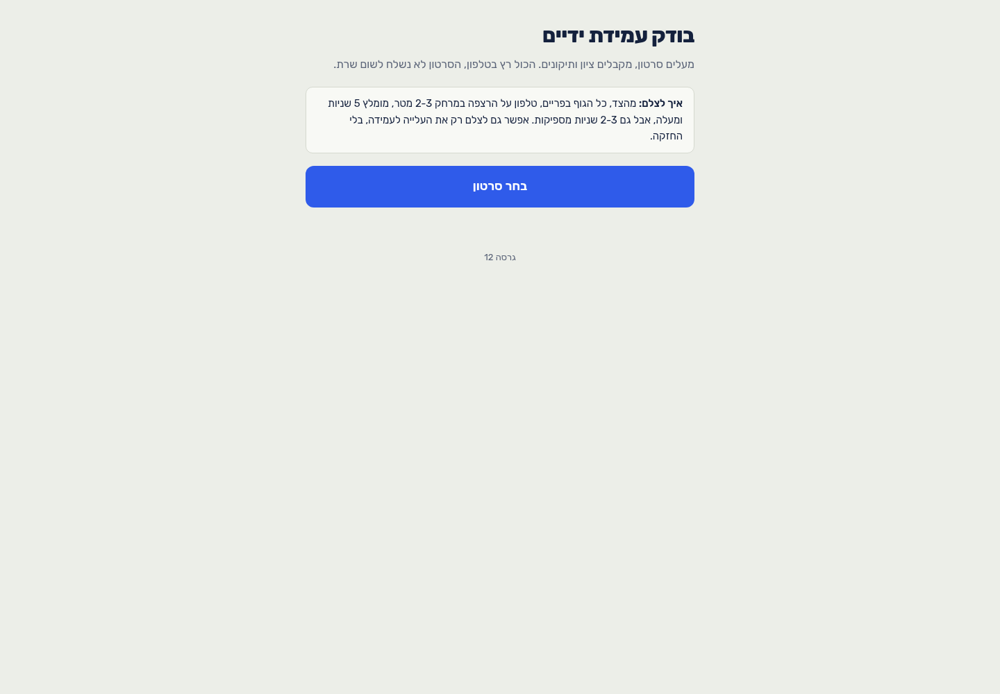
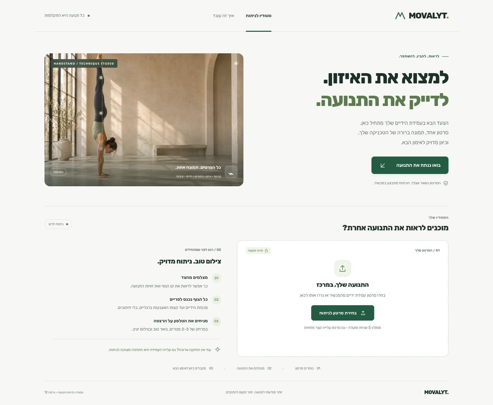
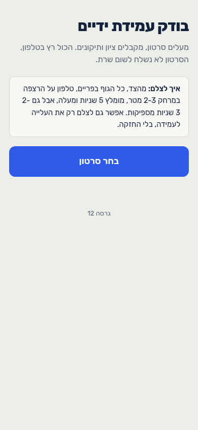
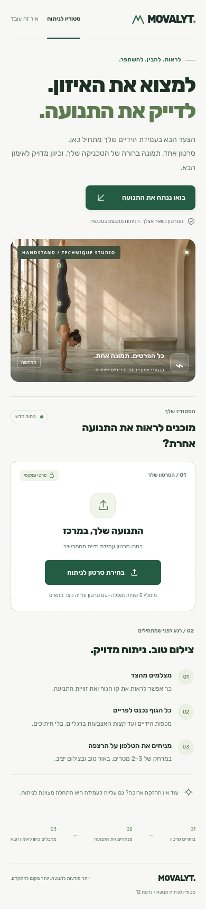

# MOVALYT — שדרוג סטודיו ניתוח התנועה

ענף: `design/movalyt-analysis-studio`. המסך שנבחר: מסך העלאת סרטון עמידת הידיים ב־`index.html`.

## מה נמצא בבדיקה הראשונית

1. **מסך פתיחה — תקין אך בסיסי:** אזור צר ברוחב 560 פיקסלים משאיר רוב מסך המחשב ריק. הכותרת, הסבר הפרטיות והנחיות הצילום מופיעים כרצף טקסט ללא מותג או המחשה.
2. **בחירת סרטון — תקינה:** כפתור יחיד וברור, אך ללא אזור גרירה, שם קובץ נבחר או חלוקה נוחה של הנחיות הצילום.
3. **ניתוח ותוצאות — מנגנון קיים שנשמר:** MediaPipe מקומי, ניתוח עלייה והחזקה, מדדים, עצות ותרגילים, וידאו עם שלד וגרף זמן. גרסת `preview/` כוללת בנוסף משוב מאמן ו־Gemini ואינה משתנה במסגרת העבודה.

## מה השתנה

- מערכת חזותית חדשה: רקע בהיר, ירוק עמוק, טיפוגרפיית Rubik מקומית בעברית, אייקוני SVG וגריד מותאם למחשב ולמובייל.
- מיתוג MOVALYT וכותרת שמסבירה את הערך, עם כפתור שמוביל ישירות להעלאה.
- תמונת המחשה ייעודית שנוצרה ב־Image Gen, עם סימון ברור כהמחשה וקו גוף דקורטיבי. הנקודות בתמונת הפתיחה אינן תוצאת ניתוח.
- אזור העלאה באמצעות בחירת קובץ או גרירה ושחרור, הצגת שם הקובץ ומשוב לקובץ שאינו וידאו.
- שלוש הנחיות צילום ברורות: מבט מהצד, גוף מלא בפריים וטלפון יציב בגובה הרצפה.
- מעברים ואנימציית כניסה עדינים, מצבי hover/לחיצה/פוקוס, תמיכה ב־`prefers-reduced-motion`, קישור דילוג למקלדת, RTL ובורר קבצים מקורי של המכשיר.
- עיצוב עקבי לציונים, המדדים, עצות, בקרי הניגון והתוצאות, תוך שמירה על כל התוכן הקיים.

## גבולות השינוי

מודול `<script type="module">` של מנוע הניתוח נשאר זהה בית־לבית ל־commit הבסיס `a6930b7`.

SHA-256 של תוכן המודול:
`362283aab41d92dd92f6c2be6599c5e5a37e5de5b50da01ab093543dbc0a982e`

כל מזהי ה־DOM המקוריים נשמרו. `preview/index.html` ו־`preview/ai-feedback.js` לא השתנו. אין שינוי בספים, בחישובי הציון, בזיהוי התנוחות, במודל או בשליחת הנתונים. אין פרסום או merge לפרודקשן.

## לפני ואחרי

צילומים מאותו מחשב ובאותם רוחבי תצוגה. צילומי לפני נלקחו מגרסת הבסיס; אחרי מהענף הנוכחי.

| מחשב — לפני | מחשב — אחרי |
|---|---|
|  |  |

| מובייל — לפני | מובייל — אחרי |
|---|---|
|  |  |

## בדיקות

- `node --test tests/coach.test.mjs`: בדיקות המשוב הקיימות עברו, כולל עובדות מדודות, רשימת תרגילים מורשים ומניעת תוכן מומצא.
- בדיקת תחביר למודול הניתוח, `assets/studio.js` ולמודול המאמן.
- השוואת מודול הניתוח למקור ושמירת כל מזהי DOM.
- Chromium / Playwright ברוחבים 320, 390, 768 ו־1440: ללא overflow אופקי.
- קישור דילוג למקלדת, reduced motion, בחירת קובץ והודעת שגיאה לגרירת קובץ טקסט.
- בדיקת וידאו מקומית: יצירת WebM מתמונת ההמחשה, טעינת MediaPipe, פענוח וידאו והצגת ציונים ו־replay. זהו fixture סינתטי לבדיקת חיבור השלבים; הוא אינו מאמת דיוק מקצועי על תנועה אנושית אמיתית, ותוצאות זיהוי יכולות להשתנות בין ריצות.
- בקרי ניגון עברו בדיקה: מהירות ×0.5, פריים קודם/הבא, הזזת הסמן וניגון/עצירה. גם תוצאות הניתוח נבדקו ברוחב 390 פיקסלים ללא overflow.
- אין מכאן טענה לעמידה מלאה בתקן נגישות או לבדיקה במכשירי iPhone/Android פיזיים.

### שחזור מקומי

אין צורך ב־build או בספריות frontend.

```sh
python3 -m http.server 4173 --bind 0.0.0.0
```

פתחו `http://localhost:4173`. להרצת בדיקות הדפדפן בטרמינל נוסף:

```sh
npm install --prefix /tmp/movalyt-browser --cache /tmp/npm-cache playwright
NODE_PATH=/tmp/movalyt-browser/node_modules node tests/ui.browser.cjs
NODE_PATH=/tmp/movalyt-browser/node_modules node tests/analysis.browser.cjs
```

ברירת המחדל היא `/usr/bin/chromium`; ניתן להגדיר `CHROMIUM_PATH` ו־`BASE_URL`. רק בסביבת בדיקות עם תעודת proxy פנימית שאינה מוכרת לדפדפן ניתן להוסיף `ALLOW_TEST_PROXY_CERT=1`; אפשרות זו נמצאת בכלי הבדיקות בלבד ואינה משחררת בדיקות TLS באפליקציה.

## נכסים

- `assets/handstand-training.webp`: המחשה שנוצרה במיוחד ב־OpenAI Image Gen, כ־105KB. אינה תצלום של משתמש או מדידה אמיתית.
- `assets/rubik-*.ttf`: Rubik ברישיון SIL Open Font License, עותק הרישיון ב־`assets/Rubik-OFL.txt`.
- אייקוני SVG וסימן המותג נבנו בקוד, ללא תלות בספריית אייקונים או שירות חיצוני.
