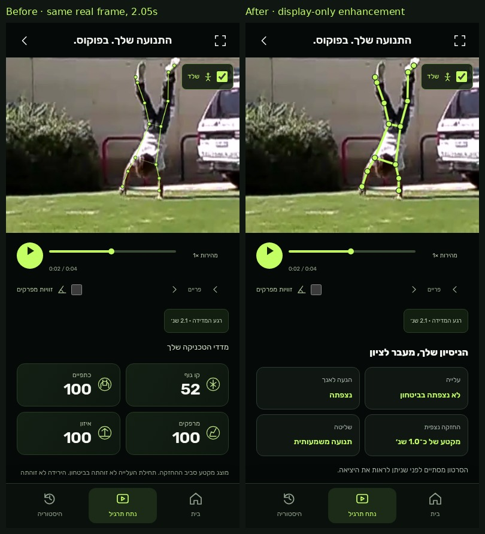

# MOVALYT — intelligent handstand analysis

> Initial PR #30 snapshot. The [mobile refinement](pr30-mobile-fixes.md) supersedes
> the overlay, entry-observation and report layout described below.

Based on PR #29 HEAD `d39701c`, on `feat/intelligent-handstand-analysis`.
[Policy written before implementation](handstand-analysis-policy.md).
No additional model, cloud API, paid service or personal video was used.

## What changes

- Separate local temporal, ending-analysis, coaching and display modules.
  Raw MediaPipe points and actual sample times support observed ascent/reach,
  continuous inverted hold, control and exit evidence. Missing phases stay unknown.
- Hold time excludes rapid ascent/leg-lowering transitions and missing samples.
  It is an observed interval, not certified free balance. Missing boundaries are
  labeled as a partial interval; no complete-duration claim or time target follows.
- Ending analysis examines pelvis-to-wrist drift/speed/direction, tilt, shoulder
  and body-line changes, optional leg separation and genuinely growing oscillation.
  Controlled-descent-compatible, possible balance loss, unclear ending, lost
  tracking and cut-off video are distinct. A moving/hand-walking position alone
  does not establish departure. No assertion about intention, impact, finger
  pressure, fatigue or a definite cause of falling.
- Feedback gives measured strengths, a primary issue, timestamped evidence,
  a bounded possible explanation (or unknown), two relevant drills and an optional
  measurable practice goal. Short/unstable holds replace generic high-score praise.
- Shared overlay renderer: roughly 3–4 CSS-pixel lime strokes, outlined joint dots,
  subtle glow, CSS/contain-aware sizing, moderate bounded display-only filtering.
  No weak/missing-joint carry-forward. Playback interpolation uses actual sample
  times; `requestVideoFrameCallback.mediaTime` aligns supported browsers with the
  presented frame, with animation-frame fallback. Seek/end/retry cleanup avoids
  stale frames. Angle readouts and all measurements still use raw points.
  Media and overlay share one canvas; decoded browser orientation applies to both.
- Unscored attempts cannot navigate to an empty result ring. Existing UI,
  onboarding, skeleton toggle, cancel/retry and local score history remain.

## Score comparison

The numeric formula, weights, scoring thresholds and reliability block are
unchanged. Duration/control are separate evidence, not an arbitrary deduction.
History retains its existing model IDs and comparable scores.

| Fixture | Before | After | New observed hold | Coaching focus |
| --- | ---: | ---: | ---: | --- |
| Synthetic good short hold | 100 | 100 | 3.1s | Balance practice; suggested 3×4s goal |
| Synthetic good long hold | 100 | 100 | 20.1s | Repeat quality; suggested 3×20s goal |
| Synthetic significant sway | 90 | 90 | 5.1s | Smaller corrections; no extra duration |
| Synthetic arch | 85 | 85 | 7.1s | Line work; supported short practice |
| Existing real moving clip | 71 | 71 | partial interval only | Observed motion; ending not visible |

[Independent baseline/current outputs](screenshots/intelligent-analysis/score-comparison.json).
Synthetic cases are software tests, not measurements of the reported athlete.
The real clip is handstand walking, not an annotated fall dataset. Transcoding
and reframing can change MediaPipe outputs: derived rotation-metadata clip scored
73, portrait/cropped variants 71. This is not a changed formula or proof of
viewpoint invariance.

Example from the synthetic short case: before, **“לא נמצאה חריגה בולטת במדדים
שניתן היה למדוד.”** After, **“ההחזקה קצרה, גם כשהמנח נראה טוב. התמקדו בשליטה
ובצבירת החזקות עקביות לפני ניסיון ממושך.”** Two drills target small balance
corrections near a wall and repeated short holds. A 4-second practice goal is a
suggestion based on the measured interval, not a predicted capability.
The previous inverted window was 4.4s; the new hold observation is 3.1s after
excluding transitions. The actual athlete's video was not available/authorized.

## Verification and screenshots

- **83 Node tests passed**: all requested scenarios, censored/weak/malformed
  tracking, drift without a visible exit, hand/leg adjustments, raw-data immutability,
  frozen legacy scores, display filtering/confidence, contain/cover and 0/90/180/270°
  coordinate geometry. Production syntax and QA-script compilation passed.
- [Chromium mobile report](screenshots/intelligent-analysis/mobile/chromium-report.json):
  320/375/390/430, actual inference from the cached motion clip, 42 samples,
  Worker/CPU, same score 71, moving skeleton, play/pause/speed/angles,
  onboarding, safe-area simulation, reduced motion, cancel/retry, history/refresh,
  no-pose rejection and storage-denied handling. No overflow or uncaught errors;
  intentional cancellation logs its expected AbortError.
- [Actual overlay QA](screenshots/intelligent-analysis/overlay-report.json): before/
  after at **2.05s**, landscape, portrait padding, rotated pixel data with **90°
  metadata**, true sideways pixels and cropped video. Real inference, no pose/score
  injection. Drawn endpoints stay within the bounded display-filter distance from
  measured points; tested exact sample had 0px endpoint difference. Toggle and
  320/390/430 display sizes checked. True sideways video received no reliable score.
- [Final unscored-route check](screenshots/intelligent-analysis/overlay-sideways-report.json).
  [Preserved contracts](screenshots/intelligent-analysis/preserved-contracts.json):
  Worker/runtime/sampling, legacy summary/AI/cloud/Coach and onboarding/history
  modules remain byte-identical to baseline. No SSO, production or merge change.

[Before](screenshots/intelligent-analysis/overlay-before-390.png) ·
[After](screenshots/intelligent-analysis/overlay-after-390.png) ·
[Full feedback](screenshots/intelligent-analysis/feedback-after-full-390.png) ·
[New results](screenshots/intelligent-analysis/results-after-390.png) ·
[Rotation](screenshots/intelligent-analysis/overlay-rotation-390.png) ·
[Crop](screenshots/intelligent-analysis/overlay-cropped-390.png).

Reproduce with `node --test tests/*.test.*` and
`python3 scripts/verify-movalyt-ui.py --browser chromium --out <output>`.
Then `python3 scripts/verify-intelligent-handstand.py --baseline <d39701c-worktree>`;
`--case sideways` selects one case without repeating the full matrix. The latter
uses cached source/model and generates/reuses derived clips, never fetches a new
personal recording.

## Limits

Provisional kinematic heuristics require coach-labeled independent exit/fall
clips and device validation before accuracy claims. No calibrated sensitivity,
specificity, anatomical ground truth or confidence probability is claimed.
Camera movement, walking hands, perspective, occlusion and model hallucinations
can confound 2D inference. A high score does not establish duration or independence.
A future composite score needs validation and a new history-model version.
No physical iPhone/Android test. The known Linux WebKit inference limitation
remains; it was not repeatedly retried. Video and detailed feedback are session
only; local score history survives refresh and a video must be selected again.
