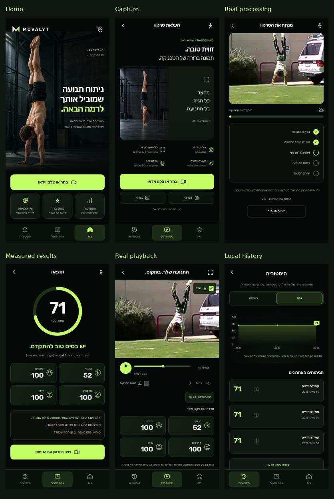
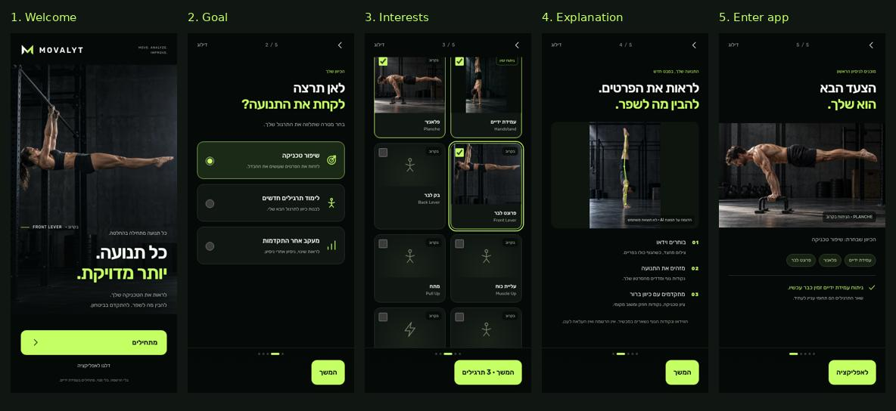
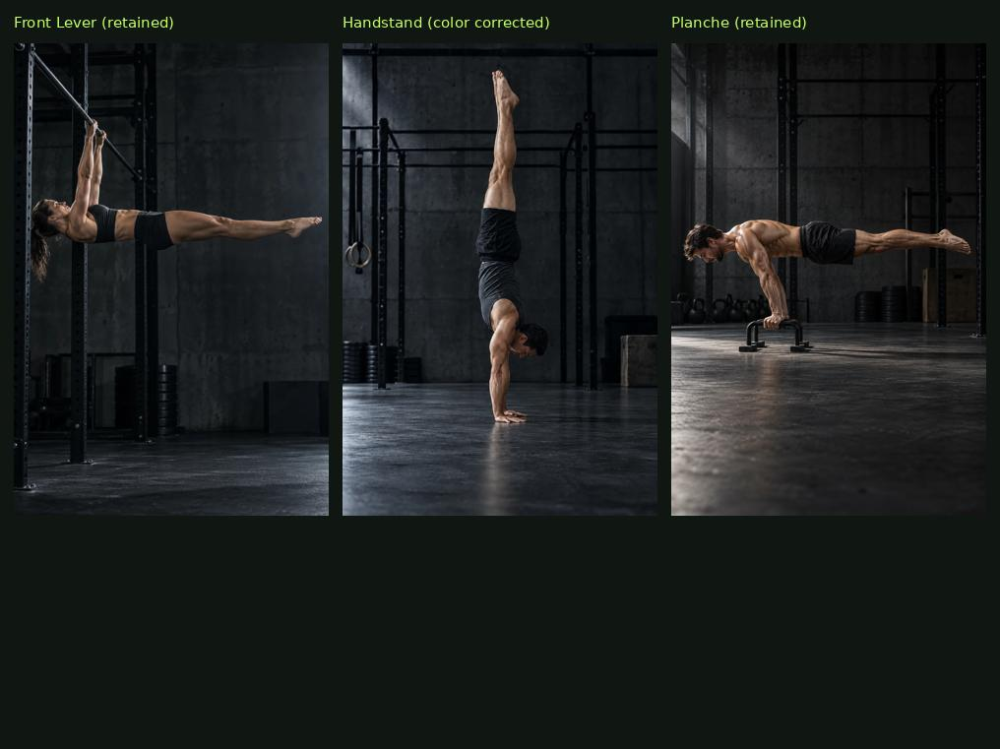

# MOVALYT — Stage B

Continues [Draft PR #29](https://github.com/eyalwow/handstand2/pull/29) on
`ui/movalyt-reference-recreation`. Stage A was approved by the overnight request;
its isolated review remains historical. No merge or production deployment.

[App Preview](https://handstand-lab-coach-git-ui-movalyt-referenc-ae8ec2-eyalwen-6443.vercel.app/vercel-app/)
uses the existing Vercel authentication. Physical iPhone/Android access and the
native photo picker have not been verified; no SSO setting was changed.

[Home](screenshots/overnight/home-390.png) ·
[Capture](screenshots/overnight/analyze-390.png) ·
[Processing](screenshots/overnight/processing-390.png) ·
[Results](screenshots/overnight/results-390.png) ·
[Player](screenshots/overnight/replay-390.png) ·
[History](screenshots/overnight/history-390.png) ·
[Full player and visible feedback](screenshots/overnight/replay-full-390.png) ·
[Measured joint angles](screenshots/overnight/replay-angles-390.png) ·
[Empty history](screenshots/overnight/history-empty-390.png) ·
[Catalog](screenshots/overnight/catalog-390.png) ·
[Settings](screenshots/overnight/settings-390.png).

## Completed

- Approved athlete-first home and different capture image integrated into the real
  app. Compact guidance replaces the dashed camera frame. Fixed three-tab mobile
  navigation, local fonts, safe areas, touch targets and Reduced Motion.
- Five-step onboarding: Welcome, goal, multiple interests, labeled visual
  explanation, entry. Skip, back, first-visit persistence and settings replay.
  Unavailable/corrupt preference storage preserves existing data and permits
  session entry with an explicit notice. No account or paywall.
- Extensible 20-exercise catalog, artwork metadata and analysis registry.
  Handstand alone is active; 19 entries are Coming Soon. UI, preference data,
  catalog and the existing analysis engine are separate modules.
- Actual video-centered player: thin confidence-filtered MediaPipe lines/joints,
  seek, play/pause, half-speed, frame stepping, skeleton toggle, measured angles,
  expanded view, real metric cards and expanded local coaching feedback.
- Real progress only, completion stages, cancel/retry. Real result ring,
  strengths/findings, local-only graph/history and honest empty states. Starting
  a new analysis clears previous score/cards so an unreliable retry cannot show
  stale measurements. Video itself is not persisted and requires re-selection
  after refresh; history and preferences survive.

## Photography and reference comparison

One color/light correction made capture Handstand cooler/darker to match Front
Lever. The two approved Front Lever/Planche files and home photo were retained.
[Asset provenance and pose source](../vercel-app/assets/campaign/README.md).

Home preserves the approved crop with feet/hands visible, higher lime heading,
large action and three quiet benefit cards. Capture has distinct artwork and
four clear guidelines. Processing restores the sketch's video/progress/stages.
Results use the large lime ring and 2×2 measured cards; playback puts real media
and controls first. History uses the sketch's grid/lime graph but only saved
records. Onboarding extends this direction without copying CaliPro. No desktop
phone collage was built. The exact reference photograph remains unavailable;
current artwork approximates its direction rather than matching that asset.

## Verification

- **66/66 Node tests pass**, production module syntax and Python compilation pass.
- Entire extracted `handstand-engine.js` matches the former inline script in
  `098292f` after trimming only surrounding whitespace. Scoring/constants block
  is byte-identical. Worker, pose runtime/main, sampling, summary, AI feedback,
  Gemini server and Coach API are byte-identical. Gemini remains blocked.
- [Chromium report](screenshots/overnight/chromium-report.json): 320/375/390/430,
  all six states, five onboarding steps, skip/reload/preferences/catalog,
  cancellation/retry, real moving skeleton, playback/speed/angles, history/reload,
  no-pose rejection, denied storage, dialog focus, simulated safe areas and
  Reduced Motion. No horizontal overflow or uncaught JS errors. The one logged
  AbortError is the intentional cancellation. 1440 basic usability check passed.
- Real existing UCF101 handstand-walking fixture: **71, 42 samples, Worker/CPU**
  at every width, consistent with the previous result. Cached clip/model reused;
  no static photo posing as a motion test, no scores/landmarks/history injected.
- [WebKit UI report](screenshots/overnight/webkit-report.json): onboarding,
  preferences, catalog and empty app shell passed at all four widths with no
  console/uncaught errors. Actual inference was intentionally not retried because
  of the documented Linux `GLctx.activeTexture` limitation from the
  [prior report](screenshots/mobile-refinement/webkit-report.json). This is not a
  physical Safari pass.
- Final player touch-target changes checked at all four widths using one real
  analysis, plus visible feedback/angles captures. CI and Preview status are
  recorded on PR #29; the unrelated existing Coach-demo deployment is not changed.

Reproduce: `python3 scripts/verify-movalyt-ui.py --browser chromium`; cached inputs
are retained in `../movalyt-test-cache`. WebKit UI only:
`--browser webkit --webkit-executable <installed-wrapper> --ui-only`.

## Remaining limits

Ready for the user's iPhone acceptance test, subject to existing Preview login.
No physical iOS/Android, native picker, Dynamic Island, system keyboard/dialog or
rotated phone recording was tested. Safe-area checks simulate insets. Landscape
moving fixture passed; tall real phone footage still needs device validation.
Catalog movements beyond Handstand have no engine. No packaging/store release.
