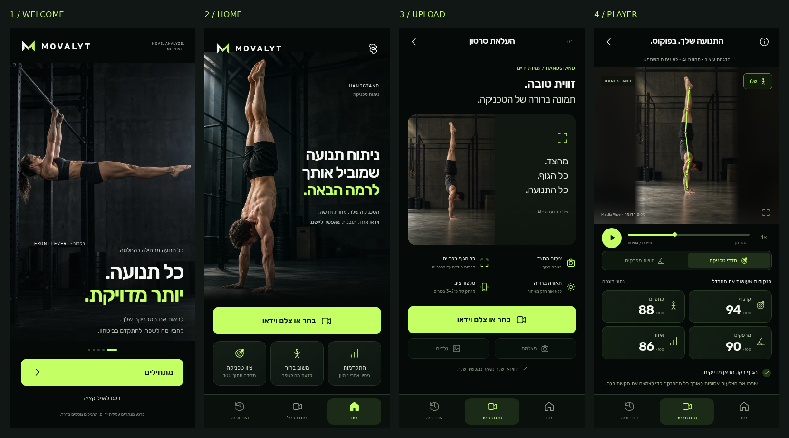
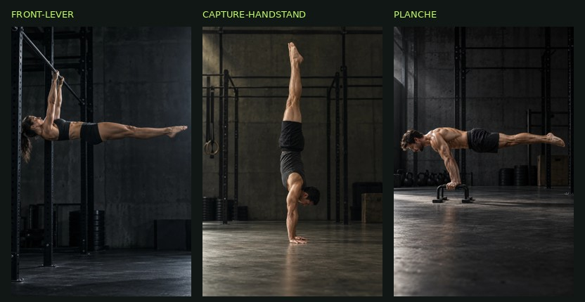

# MOVALYT — Stage A: four screens for visual approval

Continues the existing branch and Draft PR #29. **Stop after this review and wait
for the user's explicit approval before Stage B.** This is a new isolated design
proposal, not another spacing patch applied to the running app.

Review:
https://handstand-lab-coach-git-ui-movalyt-referenc-ae8ec2-eyalwen-6443.vercel.app/vercel-app/design-review/

Full-size mobile opening:
https://handstand-lab-coach-git-ui-movalyt-referenc-ae8ec2-eyalwen-6443.vercel.app/vercel-app/design-review/?capture=1#welcome

Existing Vercel authentication applies. No protection setting has been changed.

| Screen | Full 390×844 capture | Design change against the original sketches and current iPhone captures |
| --- | --- | --- |
| Welcome | [open](screenshots/stage-a/welcome-390.png) | New original female Front Lever photo, clear MOVALYT lockup, quiet step indicator, short invitation and lime start action. Skip is visible; no signup or paywall. Front Lever is marked Coming Soon. |
| Home | [open](screenshots/stage-a/home-390.png) | Headline moves up beside the athlete, photographer crop keeps feet and hands visible, a quieter two-line subtitle replaces the text block, three consistent benefit cards sit beneath the large upload action. No dashboard sections crowd the entry screen. |
| Capture | [open](screenshots/stage-a/upload-390.png) | Different original side-view photo, compact image/instruction composition, no giant dashed frame. Four practical camera guidelines, a strong upload action and secondary capture/gallery treatments. AI guidance is never presented as a live camera. |
| Player | [open](screenshots/stage-a/player-390.png) | Replaces the tall outlined viewport and scattered controls with a contained portrait illustration, soft backdrop, one transport strip, a lime timeline, measured-pose visibility switch and technique/angle views. Four large score cards and technical feedback are visible without disclosures. |

## Reference handling

The two original sketches remain the visual reference, with mobile prioritized.
The three supplied iPhone screenshots describe the current problems. The 79-second
WhatsApp/CaliPro video was inspected as a flow reference: short welcome, deliberate
choices and an explanation of value before entry. None of its branding, artwork,
copy, screens, recordings or design assets were copied into this proposal.

All interface text, cards, navigation, controls, pose overlay and layout are real
HTML/CSS/SVG. No complete reference sketch is used as an image background. The
new view has its own scoped stylesheet and does not append overrides to the
running app's CSS.

## Asset approval

Original Front Lever, capture Handstand and Planche photographs were generated
in the same dark industrial sports direction. All were inspected before encoding.
The existing male handstand photograph remains the home hero; the capture screen
uses a different athlete/photo. Planche is available for asset review but no
catalog or new analysis feature has been activated. Provenance and pose-generation
details: [design review README](../vercel-app/design-review/README.md).

The exact athlete from the original sketches is not independently available.
These new AI images approximate the direction; anatomy/camera/crop still warrant
human design review and do not constitute coaching evidence.

## Demo boundary

The active app remains byte-for-byte unchanged from `a77a16a` outside the new
`design-review/` directory. No engine, scoring formula, detection threshold,
Worker, WebKit path, application history, Gemini or Coach code was edited.

The proposed player is visibly labeled as a design demonstration with an AI image,
not a user analysis. Its numeric metric scores, timeline and feedback are explicit
layout examples, isolated from the real product and storage. Transport controls
are disabled. The skeleton is real MediaPipe output on the AI photograph; the
angle view measures that single image. No motion tracking is claimed here.

Review links only move between the four prototype screens. There is no actual
upload, analysis, onboarding persistence or live catalog wiring in this directory.
This respects the request to implement Stage A only before approval.

## Verification

- Four actual DOM viewport captures at **390×844**.
- No horizontal overflow in concept checks at 320, 390 and 430px.
- Pose visibility switch and image-derived angle cards checked in Chromium.
- Review dialog/Escape dismissal and navigation checked; Reduced Motion styling
  and safe-area insets are included.
- JavaScript syntax passed. No uncaught browser errors, storage writes or requests
  to the active analysis engine/API during the design review.
- No physical phone or live application video-analysis test in Stage A. Full
  integration/device validation belongs to Stage B after approval.

Reproduce: `python3 scripts/verify-stage-a-design.py`.
Machine-readable results: [review-checks.json](screenshots/stage-a/review-checks.json).

## Awaiting approval

Please review the four screens and the asset direction. Stage B has **not** begun:
goal selection, multi-select exercise choices, further onboarding explanation/end
screens, first-visit persistence, settings replay, the expandable exercise catalog,
live player wiring, remaining application screens and full mobile analysis QA are
all pending explicit design approval. Only Handstand will have an active engine;
future exercises will remain Coming Soon. No merge or production release.
