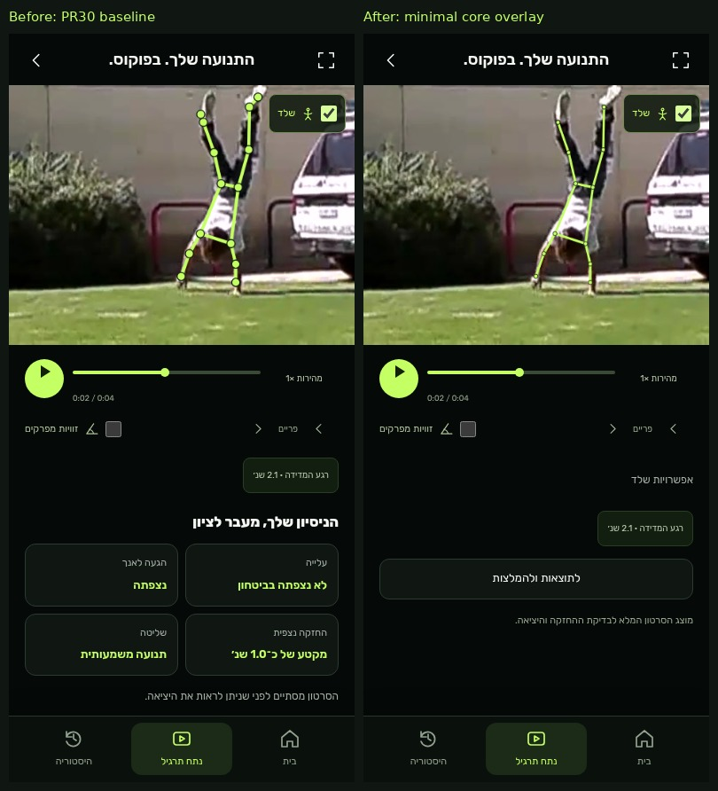

# PR #30 — minimal overlay, entry observation and one report

Continues the same Draft PR/branch. Baseline: `8f54f99`.

## Confirmed root cause

The supplied side-view video was tested locally with real MediaPipe/Worker output.
Sampling included the beginning, timestamps were ordered, and the relevant frames
passed the existing confidence and coverage gates. Cropping/rotation was not the
failure. The exact rejected predicate was:

`firstPelvisY - lastPelvisY >= 0.15 * bodyLength`

Standing-to-handstand rotation does not require the pelvis to move upward in the
image by that amount. The chosen legacy window therefore rejected a visibly
complete entry. There was also a second presentation gate: the timeline refused
to report an ascent unless a numeric entry score existed.

The new **phase observer** checks actual visible preparation, measured leg rise,
and three consecutive complete near-vertical samples. It retains confidence
0.65, at least eight valid samples, 80% coverage, minimum duration and tracking-gap
checks. An already-inverted start or a partial rise cannot satisfy the transition.
This is separate from score eligibility: an ascent can be observed without a
separate technique grade. The advanced report states that distinction explicitly.

**No numeric scoring formula, metric, score eligibility or MediaPipe threshold
changed.** The legacy gate now emits an optional local diagnostic reason; its
scoring behavior is preserved. The existing public moving fixture stays 71 → 71.
The supplied clip also retained its before/after numeric score in the local test.

## Report hierarchy

1. Overall technique score and clearly labeled measured hold interval.
2. One measured strength.
3. One primary improvement focus.
4. Concise evidence and an appropriately uncertain ending explanation.
5. Two visible drills, then a next-practice target only when supported.
6. Detailed metrics/supporting evidence inside **closed-by-default** advanced details.

The player links to this canonical report. Repeated player metric cards, mirrored
phase grids and copied result-highlights paragraphs have been removed from the
visible flow. Numeric evidence appears once centrally. Each new analysis resets
advanced details. Route scrolling owns the initial position rather than a second
smooth scroll from the engine.

## Overlay

Default: **12 core joints** — shoulders, elbows, wrists, hips, knees and ankles.
No default heel/toe/face/hand-detail circles or foot connectors. Uniform rounded
lime lines (about 2.1–2.8 CSS pixels), smaller 2.35px joint markers, no glow.
Separate **Advanced Overlay** exposes the 33 model points and full connections,
with smaller markers and the same confidence/bounds checks. Turning it on never
changes measurements. Display filtering/interpolation stays separate from raw
points. Hidden-video playback has an animation-frame fallback. The skeleton toggle
and observed video orientation are preserved.

[Before](screenshots/pr30-refinement/overlay-before-390.png) ·
[Minimal](screenshots/pr30-refinement/overlay-after-390.png) ·
[Advanced](screenshots/pr30-refinement/overlay-advanced-390.png) ·
[Report before](screenshots/pr30-refinement/report-before-390.png) ·
[Report after](screenshots/pr30-refinement/report-after-390.png) ·
[Full report](screenshots/pr30-refinement/report-full-390.png) ·
[Advanced report](screenshots/pr30-refinement/report-advanced-390.png).

[Short moving overlay video](screenshots/pr30-refinement/overlay-minimal-motion.mp4):
2.77s, 83 distinct rendered frames, H.264, no audio. Recorded from the actual app
canvas during playback using the existing public UCF101 moving fixture, then
encoded with local ffmpeg. No paid service. This public fixture begins inverted;
its correctly missing ascent is not the supplied clip's regression result.

## Verification

- **89 Node tests passed**, including constant-height-pelvis full entry, already
  inverted, partial ascent, raised-arm preparation, confidence/gaps/coverage,
  raw-landmark immutability, and core/advanced overlay point selection.
- Supplied video: real inference before/after; full ascent observed after the fix;
  actual held-start and pre-completion cuts rejected. Score unchanged. Test media,
  derivatives, screenshots and raw poses remain outside the repository. Only
  non-identifying pass/fail outcomes are included here.
- [Public display/report checks](screenshots/pr30-refinement/checks.json): 12 versus
  33 joints, uniform line width, exact central-text de-duplication, report details
  initially closed, two visible drills, widths 320/375/390/430, actual changing
  canvas during playback and no uncaught errors.
- [Mobile flow](screenshots/pr30-refinement/mobile-checks.json): real inference,
  moving playback, skeleton/angles, cancel/retry, onboarding, history/refresh,
  safe-area simulation, reduced motion and no horizontal overflow at all four widths.
- [Preserved engine contracts](screenshots/pr30-refinement/preserved-contracts.json):
  scoring/constants/reliability byte-identical; Worker/runtime/sampling, fall
  analysis, AI/cloud/Coach and onboarding/history modules unchanged.

Reproduce public checks with `python3 scripts/verify-pr30-refinement.py --baseline
<8f54f99-worktree> --record-motion`. For the provided side clip, use
`--private-video <local-file> --out <outside-repository-folder>`; the default 4.5s
held-start and 3.5s partial cuts were chosen for that specific clip, and are CLI
options for other recordings. The script rejects private output inside the repo.

No physical iPhone/Android testing was available. Existing Linux WebKit inference
limitation remains; no equivalent failing retries were repeated. No new model,
paid API, merge, production, Coach change or global SSO change.
